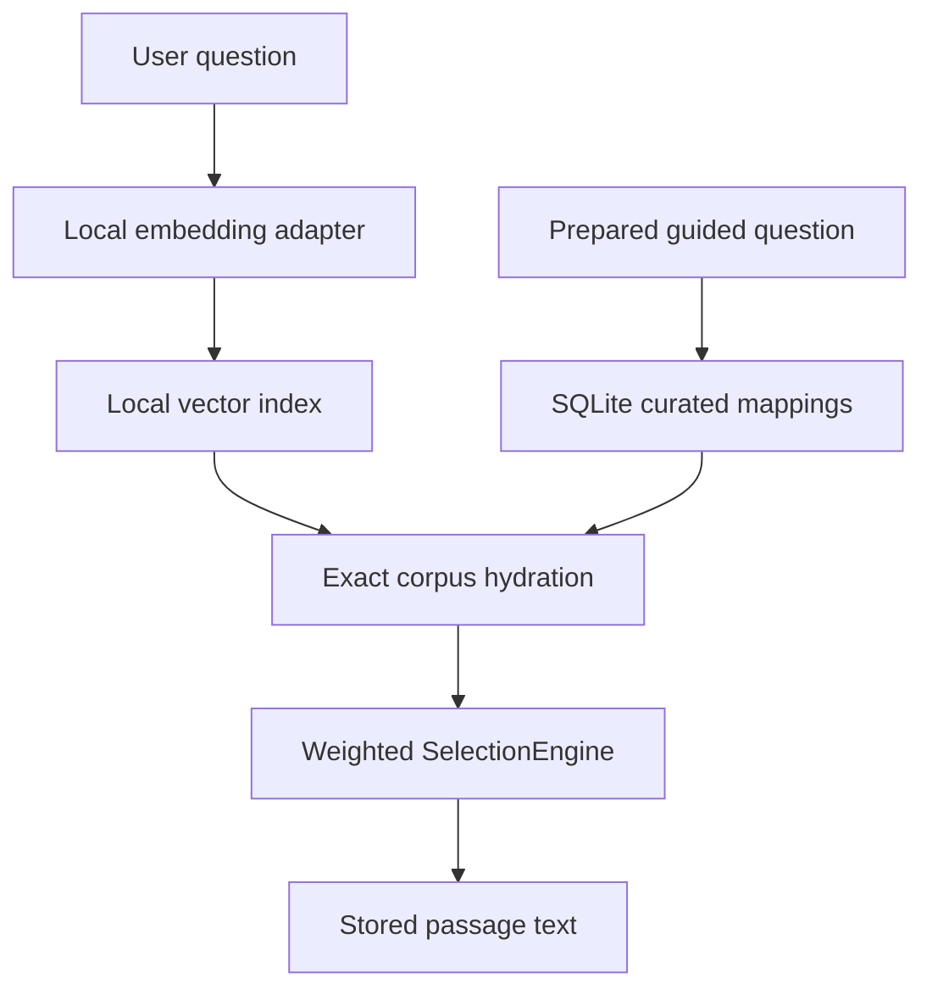

# Sibyl — Flutter edition

Offline-first literary discovery. A question is processed locally, a **pool** of related passages is retrieved, and a weighted, controlled-random selector returns **one exact stored literary passage**. Generated hints and LLM outputs are never presented as quotations.

This is an independent **Flutter/Dart** repository migrated from the Kotlin Multiplatform Sibyl project. The Python corpus-processing and format-v4 packages remain compatible with their originals. This source handoff includes Flutter app source, but platform runner directories are generated once by the Flutter CLI on your workstation (see below). No remote backend is necessary.



## Fast visual preview on Intel macOS

Install Flutter/Dart and Xcode command-line tools as described in [`docs/INSTALLATION.md`](docs/INSTALLATION.md). From the repository root:

```bash
cd app
flutter create --project-name sibyl --platforms=macos,android,ios,windows,linux,web .
flutter pub get
flutter devices
flutter run -d macos
```

**Guided questions are now visible immediately, even without a generated corpus.** The app bundles the exact catalog of 66 prompts (55 questions and 11 states), with search and theme grouping. Select a prompt to inspect it; without a prepared local corpus, `Find passage` remains disabled and explains why. Switch to `Own question` to try the explicitly synthetic demo. No literary text is fabricated for unavailable questions.

The optional `app/bootstrap.sh` wraps the first three setup commands; from the repository root you can also run `make bootstrap-flutter` followed by `make run-macos` (or `make run-web`). This launches a **clearly labelled synthetic fixture demo**; no models or downloaded books are needed. Generate hosts without `--overwrite` to preserve the existing Dart files. Run `flutter run -d chrome` for the web demo, or select Android/iOS simulators. Linux/Windows desktop builds must be launched on their own operating systems.

## Real prepared corpus on macOS

The Flutter port can read the existing **format-v4 SQLite corpus** and curated guided-question mappings directly. The catalog is always shown, but only prompts with published mappings can produce a literary passage; `Another passage` continues to select from the stored candidate pool. Prepare a corpus with Python (see [`docs/WORKFLOW.md`](docs/WORKFLOW.md)) and run:

```bash
cd app
flutter run -d macos --dart-define=SIBYL_CORPUS_DIR=/absolute/path/to/sibyl-flutter/corpus-builder/data/output
```

On sandboxed macOS runners, the absolute corpus path must be readable by the app. The installation guide includes a development-only, sandbox-container copy workflow; an arbitrary source checkout path may be denied even though it is readable from Terminal.

**Functional boundary:** Real ONNX/E5 free-form query embedding from the Kotlin Desktop app is **not yet ported**. When an E5 corpus is loaded, guided questions work (when present), but own-question search is disabled until the native adapter is implemented and tested. Explicitly synthetic hash corpora can exercise the full Dart vector search pipeline, but are not semantic-quality substitutes. See [`docs/MIGRATION.md`](docs/MIGRATION.md) and the active spec.

## Verification

```bash
python3 -m venv .venv
source .venv/bin/activate
python -m pip install -e ./corpus-core -e './corpus-builder[dev]'
make check
cd app && flutter test && flutter analyze
```

`make check` is offline/model-free. Flutter requires a locally installed SDK and fetched Dart packages. `./run_checks.sh` is the stricter canonical gate used by opt-in worker delegation.

## Repository map

| Area | Owner |
|---|---|
| `app/` | Flutter UI, Dart domain, retrieval and read-only native corpus adapter |
| `corpus-core/`, `corpus-builder/` | Unchanged build-time Python corpus pipeline |
| `corpus-format/` | Versioned SQLite/manifest contracts (v4) |
| `corpus-sources/`, `corpus-curation/`, `test-corpus/` | Provenance/rights, guided curation and synthetic fixtures |
| `docs/` | Stable product/architecture/installation/workflow/implementation docs |
| `docs/specs/STATE.json` | Sole Git-tracked processing checkpoint, **not** a live run or acceptance record |
| `docs/specs/active/subspecs/*-implementation-plan.md` | Advisory plans authored by MAIN_MODEL beside normative staged specifications |
| `tools/agent-pipeline/` | Source-bound, opt-in Aider worker controller, independent-review and verification policy |
| `tools/specs/validate_state.py` | Strict processing-state validator |

## Documentation

Read [`docs/INSTALLATION.md`](docs/INSTALLATION.md) for macOS Intel, Windows, Linux, iOS/Android and web; [`docs/USAGE.md`](docs/USAGE.md) for app/build commands; [`docs/AI_DEVELOPMENT.md`](docs/AI_DEVELOPMENT.md) for MAIN_MODEL/WORKER_MODEL workflows; [`docs/specs/README.md`](docs/specs/README.md) for spec and state lifecycle; [`docs/MIGRATION.md`](docs/MIGRATION.md) for exact parity, UI smoke coverage and remaining work; [`docs/ARCHITECTURE.md`](docs/ARCHITECTURE.md) for runtime boundaries; and [`docs/WORKFLOW.md`](docs/WORKFLOW.md) for corpus preparation.

No open-source license has been selected. See [`LICENSE.md`](LICENSE.md).
