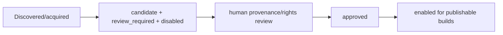

# Corpus sources implementation

## Scope

`corpus-sources/` is the permanent Git-tracked registry of source identity, provenance, rights review, and collection membership. It stores metadata, not downloaded books or generated corpus artifacts.

Policy is owned by [`../docs/SOURCES.md`](../docs/SOURCES.md); this document describes the current files and code that implement that policy.

## Layout

```text
corpus-sources/
├── catalog/       commented academic author candidates + reviewed work-selection catalog
├── works/         one TOML record per registered concrete work/source version
├── collections/   named lists of registered work IDs
└── tools/
    └── validate_registry.py
```

A work record contains work identity plus one or more concrete `text_versions`. Text-version records carry language/role, source family/URI/locator, rights state, provenance, optional translator or translation-provider metadata, and raw/canonical hashes when known.


## Academic catalog boundary

`catalog/authors.yaml` is generated/reviewed scope metadata, not provenance approval. Only uncommented author blocks are consumed by `sibyl-corpus discover-works`. The resulting `catalog/works.yaml` is rewritten deterministically: new candidates remain commented, while uncommented work entries keep their accepted IDs across refreshes.

The catalog may list multiple discovery URLs for one author/work. Availability does not imply rights approval. Once a work proceeds to concrete acquisition/registration, `works/*.toml` remains the owner of edition identity, hashes, provenance, and rights state.

## Candidate lifecycle

The registry intentionally permits disabled candidate records:



`sibyl-corpus register` in the builder writes reviewed acquired selections as **disabled candidate records**. It does not approve rights, enable publication, or overwrite an existing work.

## Validation

`tools/validate_registry.py` loads every `works/*.toml` and verifies:

- schema version and controlled enums;
- unique work/text-version IDs;
- source URIs and optional hashes;
- collection references;
- stricter provenance/hash/rights requirements for `enabled = true` records.

Every work must be referenced by at least one collection.

## Relation to generated data

The registry is intentionally committed to Git because it is reproducible project metadata. The corresponding downloaded TXT/HTML/FB2, canonical text, prepared passages, embeddings, runtime models, and corpus packages live under `corpus-builder/data/` and are ignored.
