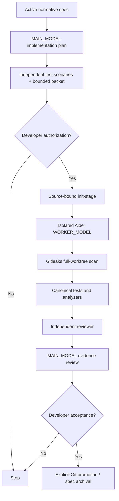

# AI-assisted software development

This engineering workflow is **not** Sibyl's literary ML runtime. The latter stays offline and extractive; coding/review agents operate only on source-code work with explicit developer authorization.

## Roles and authority

| Role | Responsibility | Not authorized |
|---|---|---|
| `MAIN_MODEL` (ChatGPT) | Architecture analysis, normative specs, independent acceptance scenarios, advisory implementation plans, bounded task packet proposals, developer-facing evidence review | Automatic promotion, final acceptance, inventing unapproved platform contracts |
| `WORKER_MODEL` (currently Aider) | Implement one developer-approved low-risk source-bound stage in an isolated Git worktree; run prescribed checks via controller | Self-approval, spec archival, scope expansion, live user-data access, merge or weakening tests |
| Independent reviewer | Fresh-context structured assessment of diff/test evidence according to policy | Superseding missing tests, human review or security gate |
| Developer | Approve provider/code exposure, risk, packet, stage, Git ref promotion and archival | Delegation of accountability to a model |

Normative instructions belong in root/local `AGENTS.md` and active specs; persisted processing checkpoints belong **only** in `docs/specs/STATE.json`. A spec companion `*-implementation-plan.md` is detailed advisory guidance, not authorization. Stable feature IDs live in `docs/FEATURES.md`.

## Stage handoff



Source-bound evidence lives in ignored private `build/reports/agent-pipeline` and detached worktrees. The processing-state `runId` is a pointer, not a claim that a process is currently running. It must not be edited during an active run. `STATE.json` forbids `RUNNING` and `ACCEPTED`; approved changes are recorded separately through Git/evidence and documented acceptance.

## Adopted from SignalHarvester

The transferred `tools/agent-pipeline/agent_pipeline.py` is the source-bound Git/Aider controller (bounded task packets, digest-checked context and plan, protected/editable paths, isolated worktrees, conservative risk, capped repairs, Gitleaks, canonical checks, reviewer, main-model checkpoint, explicit developer promotion). Its original tests were copied as regression references and must pass in this repository before any live use. The `pipeline-policy.json` has been mapped to Flutter/Python ownership and `./run_checks.sh`; `docs/specs/state.schema.json` and `tools/specs/validate_state.py` preserve strict projection semantics. SignalHarvester's `PORTING.md` is retained as reference; its Java/Gradle and backend stage instructions are **not** Sibyl requirements.

The controller still has assumptions requiring a reviewed live pilot: pinned Aider 0.86.2 and Gitleaks 8.30.1, Git SHA-1/`feature/*` promotion naming, existing clean checkout, approved external reviewer endpoint/model, command configurations, private evidence custody and branch management. Until these are satisfied, the pipeline is opt-in engineering tooling, not an automatic agent.

## Developer's first safe steps

```bash
python3 tools/specs/validate_state.py
python3 -m unittest discover -s tools/specs/tests -p 'test_*.py'
python3 -m unittest discover -s tools/agent-pipeline/tests -p 'test_*.py'
python3 tools/agent-pipeline/agent_pipeline.py --help
```

Review a candidate stage packet under `tools/agent-pipeline/examples/` against the selected spec, its implementation plan, protected paths and risk policy. **Do not run a real worker yet** merely because the packet parses. For live use, create a clean Git checkout, install pinned developer tools separately, approve sending source to the chosen provider, confirm encrypted/private run evidence retention and reviewer compatibility, and run a single reversible LOW-risk stage. Do not send corpus books, source permissions, saved questions, private keys or local `.env` to coding-model APIs.

Detailed implementation and existing CLI behavior: `tools/agent-pipeline/README.md`.
