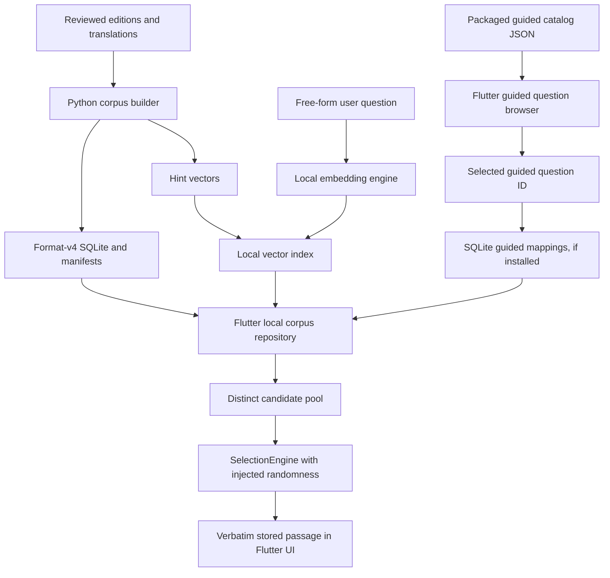

# Architecture

Sibyl has no mandatory backend. Runtime questions and selection stay on-device. Python tooling prepares/version-controls eligible literary source material **before** app distribution.

The Flutter repo intentionally has independent owners for `domain`, `retrieval`, `runtime`, `ui`, `demo`; build-time features are still owned by Python packages (`sources`, `build`, `curation`, `translation`). `corpus-format/` remains the cross-language persisted authority. The bundled guided catalog is an exact mirror of `corpus-curation/questions.json`, checked by `tools/sync_guided_catalog.py`; it is independent of runtime SQLite. The user can always browse and select its IDs, but guided answers are enabled only for IDs with stored format-v4 mappings. Format v4 guided paths resolve exact stored `passage_text` without query embedding; free-form paths require a compatible embedding engine and vector index.

**Current implementation:** Flutter native SQLite and guided retrieval are implemented for desktop; synthetic hash vectors can verify the algorithm. A real native E5 tokenizer/ONNX model adapter is not yet available. The interface boundary exists so ONNX can be introduced without modifying selection or presentation. Web intentionally uses demo-only conditional imports; Android/iOS real-corpus packaging is not yet implemented.

Data correctness is non-negotiable: stored text is not rewritten; machine translations carry provenance and a visible label; a generated semantic hint is not a quote. History and saved encounters are in-memory UI state in the present port, matching the Kotlin demo boundary.

The development agent workflow is a **separate** offline-repository engineering system with opt-in external coding/review providers. It is not part of the app runtime. See `AI_DEVELOPMENT.md`.
