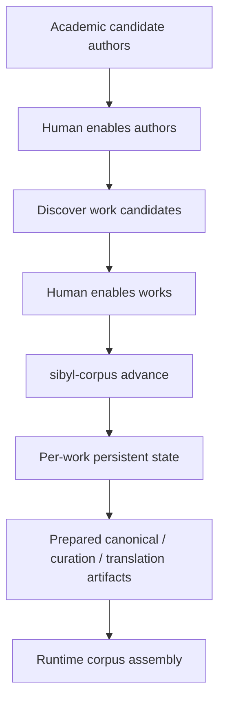

# Sibyl Corpus Preparation Platform v2 — state-driven work preparation

**Status:** active specification  
**Scope:** corpus source catalog, per-work orchestration state, resume/recovery, locking, and incremental preparation

## Goal

Turn corpus preparation from a collection of author-oriented manual commands into a local,
state-driven workflow over stable literary works. Human review remains explicit at the two points
where project scope is chosen: which authors should be explored and which discovered works should
be prepared.

The intended control flow is:



## Current state

- source discovery is primarily an explicit per-author/catalog command producing local
  `selection.toml` files;
- independently prepared source sets are reusable and runtime assembly is already deterministic;
- curation and translation have explicit validation boundaries;
- there is no Git-tracked academic author seed catalog, no single human-reviewed work-selection
  catalog, and no persistent orchestration state/index;
- repeated preparation still requires the developer to remember which command should run next.

## Requirements

### R1. Academic candidate author catalog

Add a Git-tracked candidate catalog at:

```text
corpus-sources/catalog/authors.yaml
```

The initial file is generated through LLM-assisted research based on major philology curricula,
established literary-history coverage, and broad world-literature programs. It must contain both
Russian and foreign authors and useful discovery URLs where available.

All candidate author blocks are commented out by default. Uncommenting a complete block is the
human decision to request work discovery for that author.

The catalog is planning/review metadata, not source-rights approval and not processing state.

### R2. Repeatable work discovery from enabled authors

Provide an explicit command:

```bash
sibyl-corpus discover-works \
  --authors corpus-sources/catalog/authors.yaml \
  --output corpus-sources/catalog/works.yaml
```

The command must:

- read only uncommented author entries;
- try configured author discovery sources independently so a broken URL does not prevent a
  fallback source from succeeding;
- discover literary works and concrete candidate URLs;
- exclude obvious letters, correspondence, memoirs, criticism, bibliography, and non-literary
  containers;
- merge matching title candidates from multiple sources when safely possible;
- write every newly discovered work as a commented block;
- preserve already uncommented works and their accepted IDs across refreshes;
- remain explicit networked build-time tooling; package import and validation never trigger it.

The generated catalog is:

```text
corpus-sources/catalog/works.yaml
```

It may also be created or edited manually as long as it satisfies the same contract.

### R3. Stable work identity begins at human acceptance

Discovery may propose a readable deterministic candidate ID, but it is not authoritative merely
because a tool generated it. Uncommenting the work entry accepts that ID as the stable `work-id`.

After acceptance:

- refresh must preserve the ID;
- `advance` must never invent or silently rename it;
- rebuild, curation changes, source changes, translations, and runtime-corpus composition must not
  change it.

### R4. `advance` starts from the reviewed work catalog

The future orchestration entry point is the uncommented subset of
`corpus-sources/catalog/works.yaml`, not an author URL, generated directory scan, or LLM output.

A newly enabled work receives a missing workspace automatically during:

```bash
sibyl-corpus advance
```

Source URLs in the work entry are candidates. Acquisition may try alternatives according to source
policy, but the work identity is independent from any one URL.

### R5. Two-level persistent state

Use:

```text
corpus-builder/state/index.yaml
corpus-builder/data/work/<work-id>/state.yaml
```

The global index is a lightweight scheduling/status summary. Per-work state owns detailed stage
status, fingerprints, blockers, concise errors, and references to logs/artifacts.

`advance` must use the index to avoid loading/recomputing thousands of completed works.

### R6. Controlled stage lifecycle and fingerprints

Stages use controlled states such as:

```text
pending
running
completed
failed
retryable
blocked
skipped
```

Completed stages are reused until a relevant dependency fingerprint changes. Fingerprints must
distinguish source identity, canonical text identity, processing configuration, and generated
artifact compatibility.

### R7. Resume and crash recovery

If a stage remains `running` after the owning process no longer exists, the next orchestration run
must classify it as interrupted and make it retryable or failed according to stage policy.

Large diagnostics belong in logs. Persistent state stores only concise error type/message and a
log reference.

### R8. Single-writer execution lock

Only one orchestration process may mutate preparation state at a time. Use atomic exclusive
creation of:

```text
corpus-builder/.sibyl-corpus.lock
```

Required commands:

```bash
sibyl-corpus lock-status
sibyl-corpus unlock
```

A second orchestration process must stop before state mutation. A stale lock is removed only after
explicit verification; orchestration never removes it automatically.

### R9. Atomic artifact/state publication

For a stage that produces durable output:

```text
temporary output -> validation -> atomic artifact publication -> state update
```

State must never claim a completed artifact before that artifact has been successfully published.

### R10. Failure isolation and idempotence

One failed work must not stop unrelated eligible works. `advance` reports all outcomes after the
batch. Re-running unchanged completed work must not duplicate artifacts or repeat expensive stages.

### R11. Preserve prepared literary knowledge, discard only ephemeral generated data

Validated Git-tracked curation metadata under `corpus-curation/curated/` is reusable prepared
knowledge and must not be treated as disposable cache solely because orchestration changes.

Ignored downloaded texts, runtime outputs, model bundles, embedding caches, temporary bundles, and
local generated translation text remain rebuildable local data. A migration/reset procedure may
remove those artifacts deliberately, but the repository does not need permanent reset/removal-note
documents.

## Scenarios

### S1. Enable an author and discover works

A developer uncomments Tolstoy in `authors.yaml` and runs `discover-works`. Literary candidates are
added to `works.yaml` as commented blocks; letters/memoirs are not added.

Covers R1-R2.

### S2. Accept a work and refresh discovery

The developer uncomments `tolstoy-war-and-peace`, then runs discovery again after source catalogs
change. The entry remains uncommented and retains the same `work-id`; newly found source URLs may
be added.

Covers R2-R3.

### S3. One discovery source is unavailable

An enabled author has Lib.ru and Project Gutenberg discovery sources. One fails; the other
succeeds. Work-catalog refresh continues and reports the failed source.

Covers R2.

### S4. Newly enabled work enters orchestration

A work is uncommented in `works.yaml` but has no workspace/index entry. `advance` creates its
persistent state and derives the first eligible action without changing the accepted work ID.

Covers R3-R6.

### S5. Completed corpus with one new work

A corpus has 1000 completed works and one newly enabled work. `advance` uses the global index and
does not re-run unchanged expensive stages for the 1000 completed works.

Covers R5-R6, R10.

### S6. Interrupted stage

A process terminates with one stage marked `running`. After lock ownership is resolved, the next
run marks that stage retryable/failed according to policy and continues unrelated works.

Covers R7-R8, R10.

### S7. Publication failure

Validation or atomic publication fails. The stage is not marked completed and the previously
published artifact remains authoritative.

Covers R9.

## Non-goals

- automatic approval of authors or works without uncommenting them;
- treating academic-curriculum inclusion as source-rights approval;
- migrating old downloaded/generated local data in place when clean regeneration is cheaper;
- turning persistent state into a command queue;
- runtime network access or question logging;
- deleting validated curation metadata merely because the preparation workflow changes.

## Compatibility and migration

The author/work catalogs are new Git-tracked review metadata and do not change runtime corpus
format v4. Existing `corpus-sources/works/*.toml` remains the permanent concrete text-version,
provenance, and rights registry.

During transition, existing explicit `discover`, `acquire`, `prepare-selection`, curation,
translation, and build commands remain usable. The state-driven `advance` implementation should
compose existing feature APIs rather than duplicate their internals.

## Validation

- R1-R3 / S1-S3: offline Python tests with synthetic YAML and mocked catalog HTML/network calls;
- R4-R7 / S4-S6: workflow-state tests covering workspace creation, index selection, transition
  legality, fingerprint invalidation, and interrupted-run recovery;
- R8 / S6: lock exclusivity, ownership reporting, and explicit stale-unlock tests;
- R9 / S7: staging/publication failure tests proving state is not committed early;
- R10: failure-isolation and idempotent repeated-advance tests;
- R11: repository-hygiene tests protecting Git-safe curated metadata while excluding local data;
- repository validation: focused tests first, then `make check`.

## Implementation tasks

1. Add the academic author seed catalog and repeatable `discover-works` refresh with tests.
2. Make the reviewed `works.yaml` contract the future `advance` input boundary.
3. Add global index/per-work state models, persistence, transition validation, and fingerprints.
4. Add execution lock/status/unlock behavior.
5. Implement `advance` as orchestration over existing public feature APIs with failure isolation.
6. Add concise logs/status output and owning documentation.
7. After acceptance, move durable behavior into `WORKFLOW`/`SOURCES`/implementation docs and
   archive this specification.
